# 深空当铺：可能是偷的 · 存档修改器

给 **Probably Stolen**（Steam 上叫《深空当铺：可能是偷的》）用的存档编辑器。
双击 `启动存档修改器.bat` 就能开，改完点「保存到游戏」，进游戏直接读档。

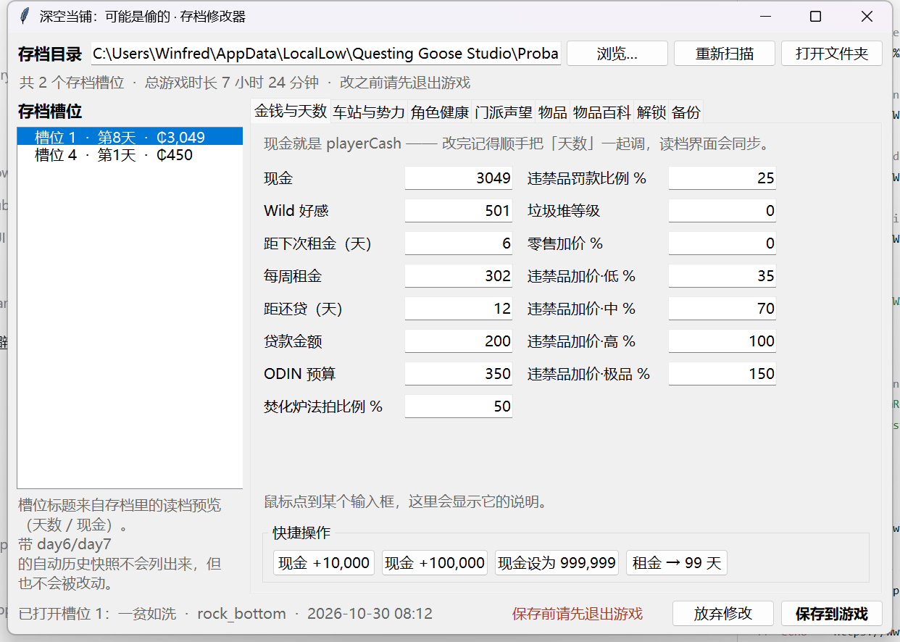

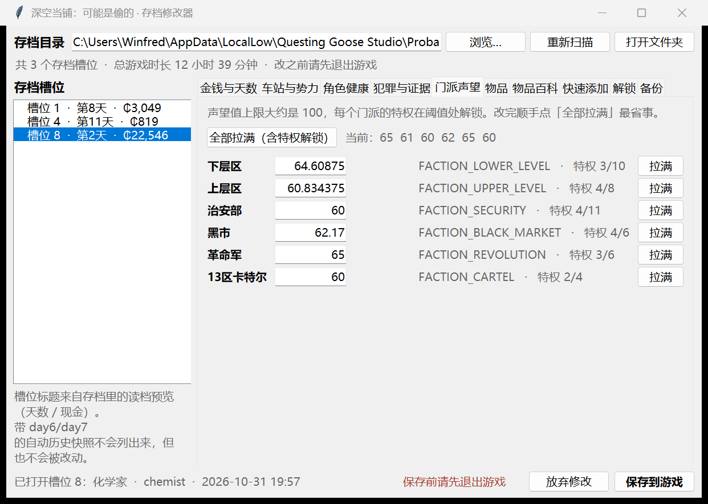

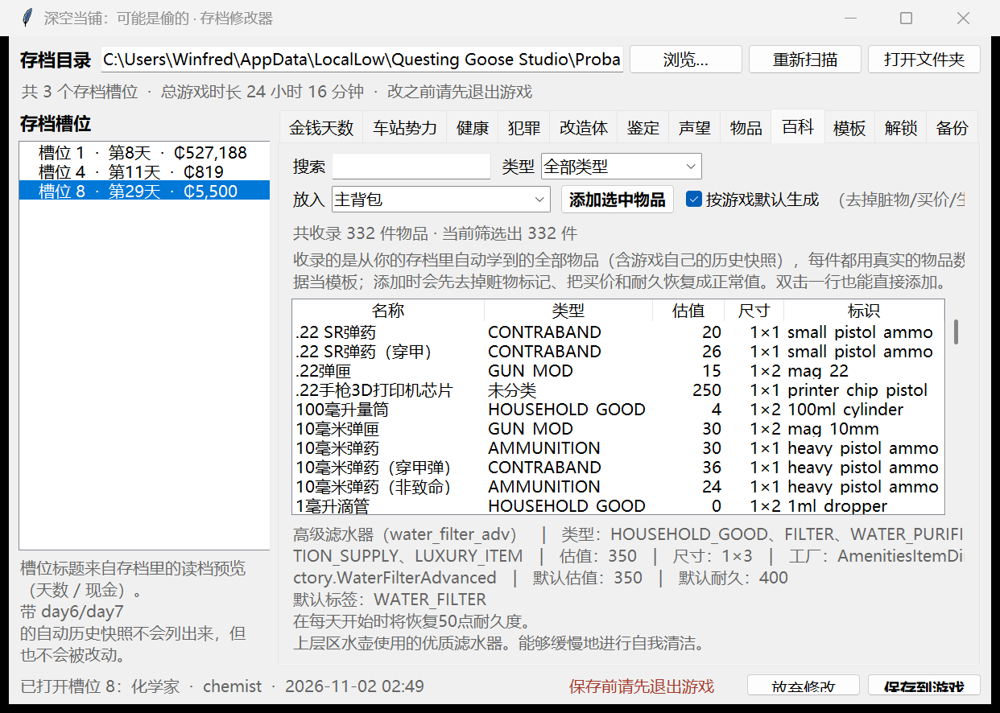

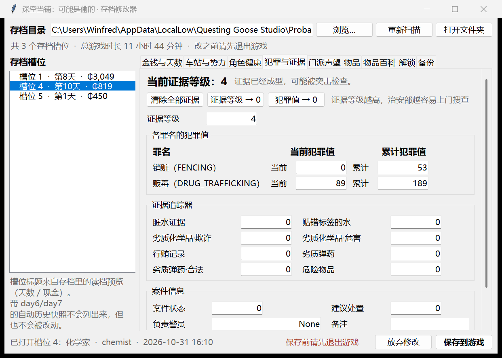

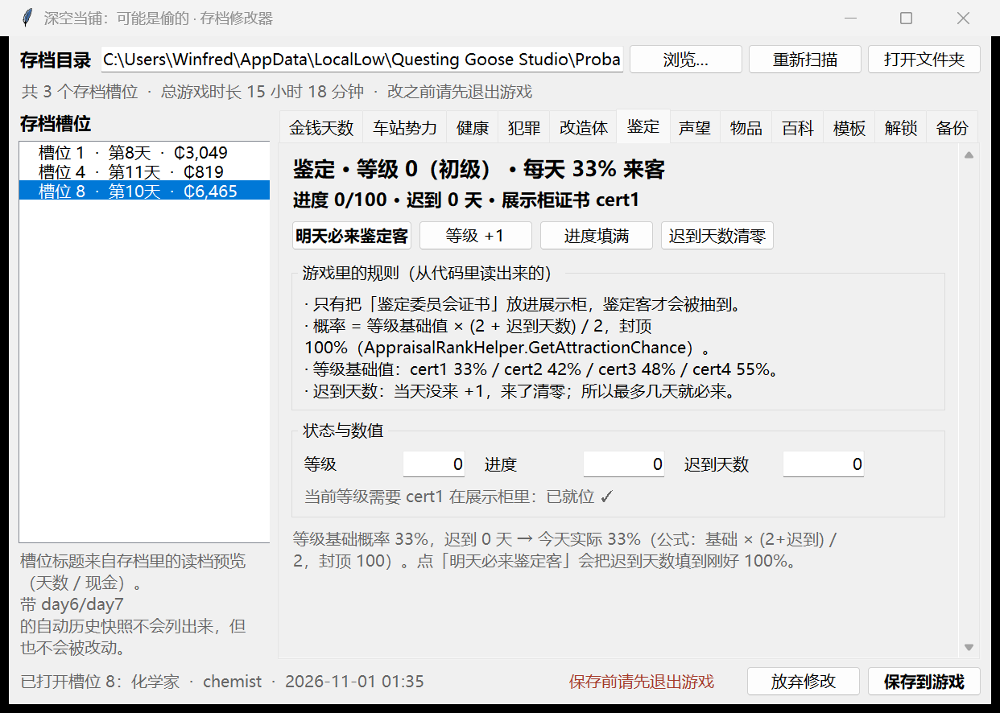

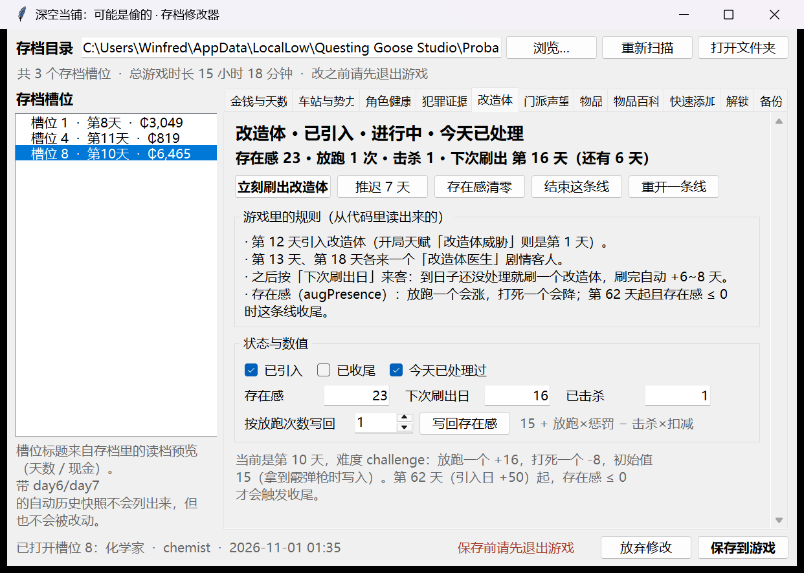

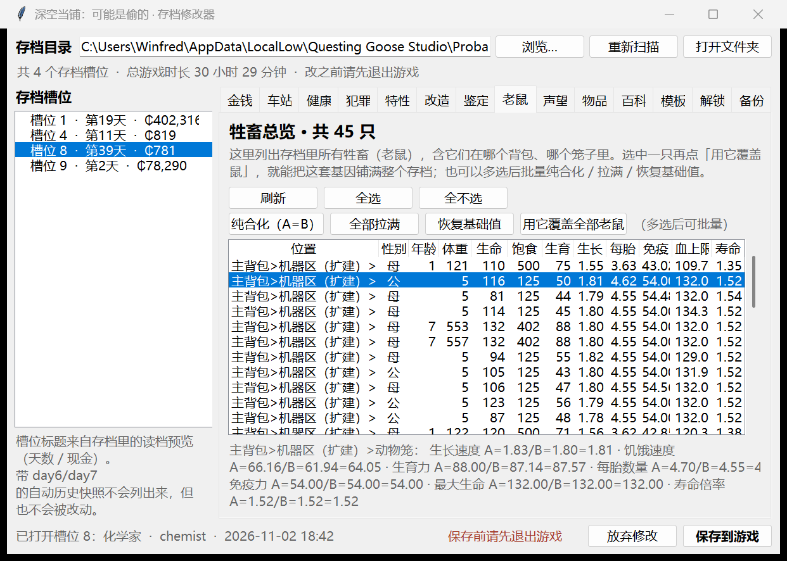

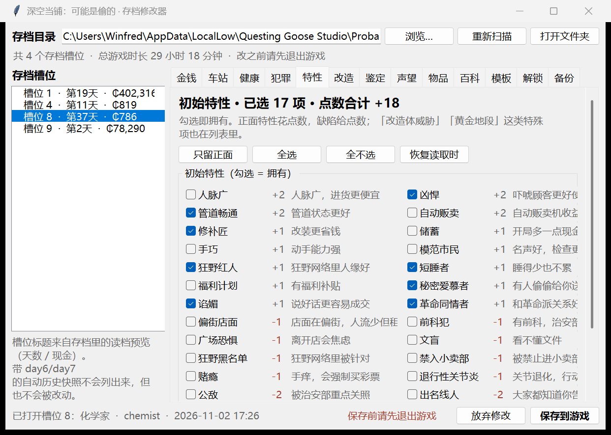

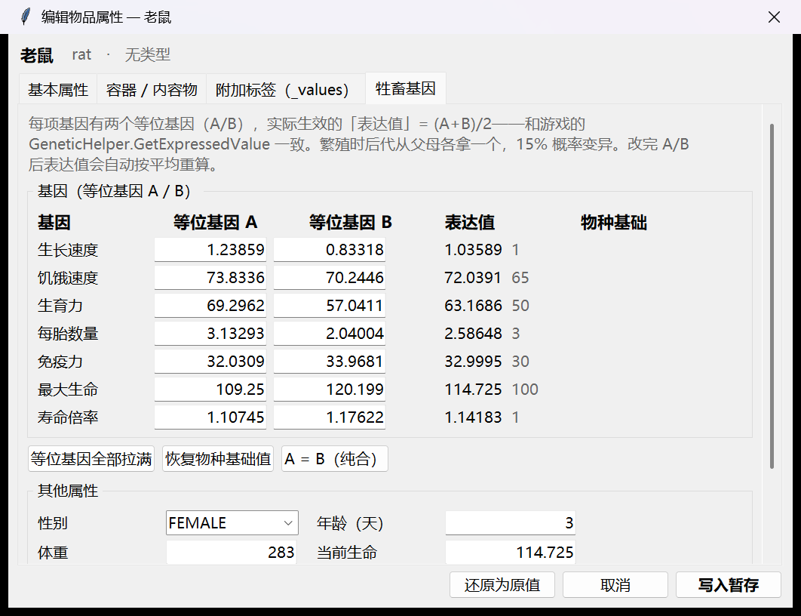

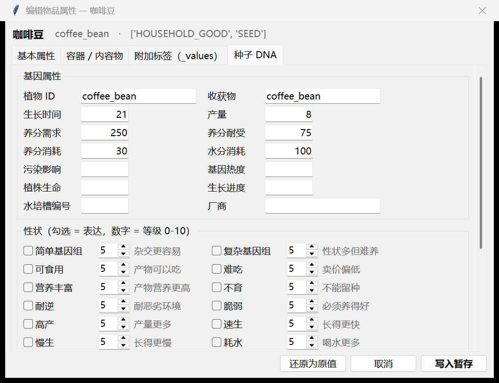

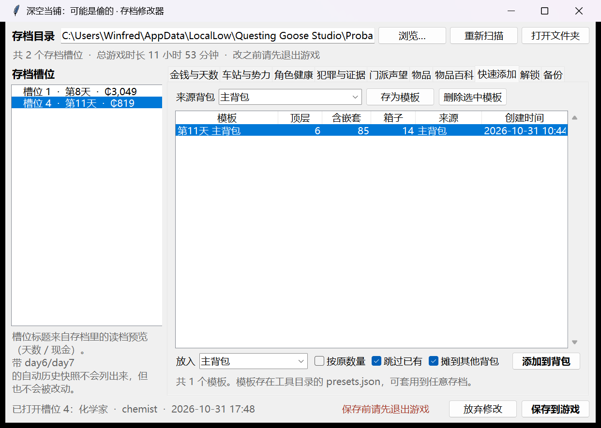

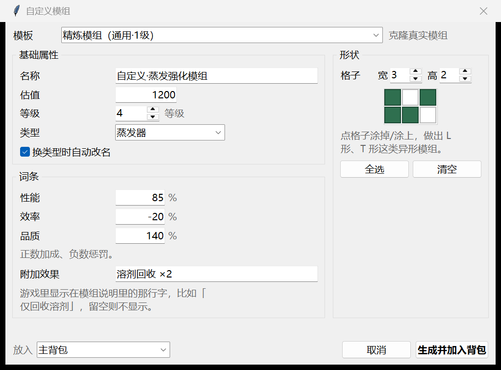

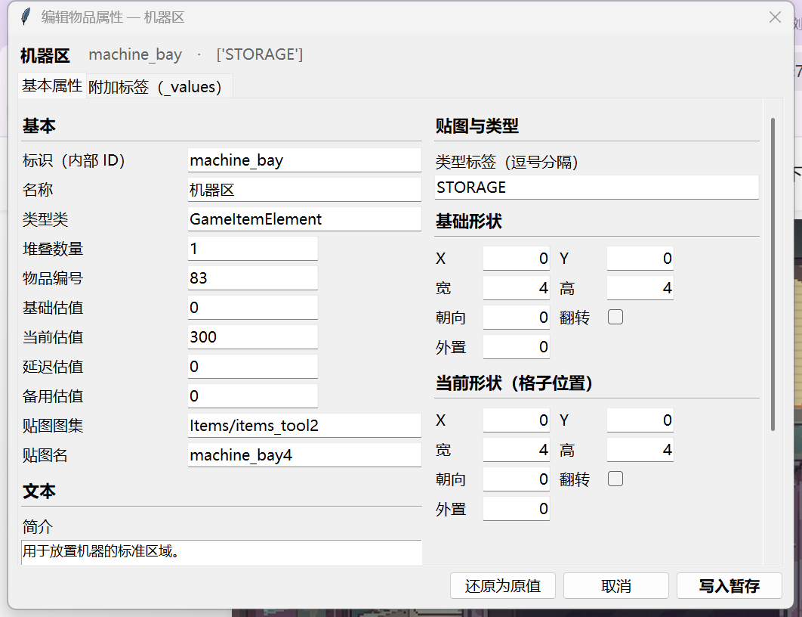

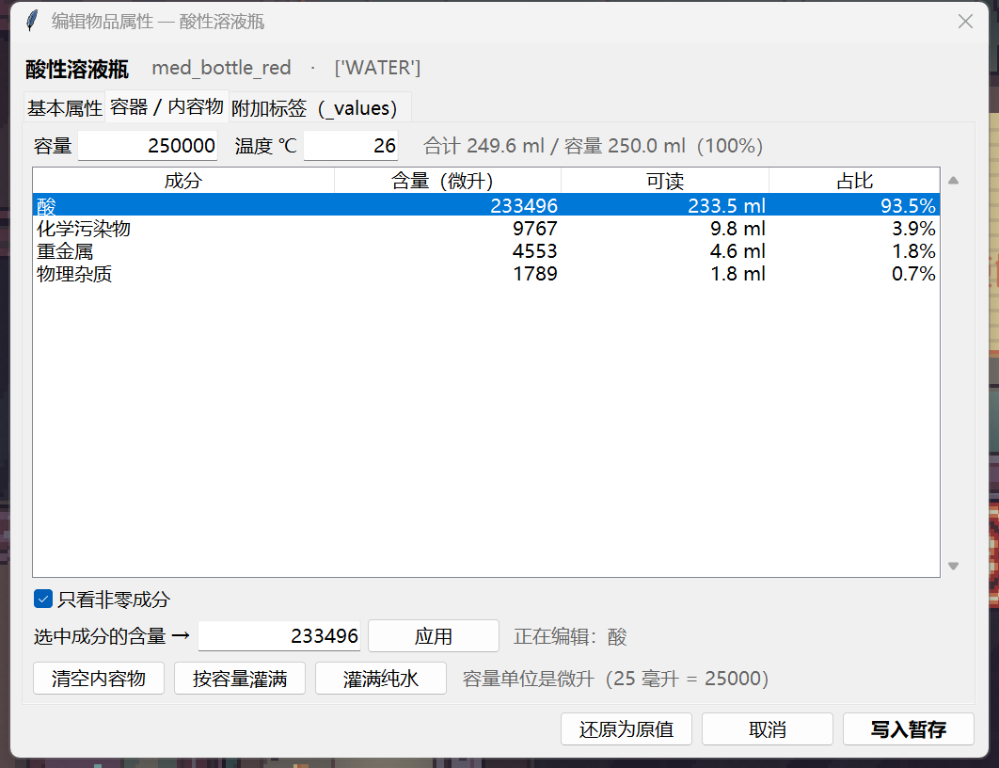

---

## 怎么用

1. **先从游戏里「保存并退出」**。游戏退出时会把内存里的存档写回磁盘，你在这之前改的东西会被整份盖掉。
2. 双击 `启动存档修改器.bat`。
3. 左边点一个存档槽位 → 改右边的数值，或者用「快捷操作 / 一键暂存」。
4. 右下角 **「保存到游戏」** → 看一眼改动清单 → 确认写入。写完会弹一句「已写入 4 号槽位……主背包 37 → 38 件」，这就是真的落盘了。
5. 进游戏读档。

> 这条只靠自觉：工具不去检测游戏进程，界面右下角有一句固定提醒，确认弹窗里也会再问一次。

想反悔：打开「备份」标签页，选一份备份点「还原」。每次保存前都会自动备份到 `_editor_backups\`。

---

## 能改什么

| 标签页 | 内容 |
| --- | --- |
| **金钱与天数** | 现金、Wild 好感、租金/贷款倒计时与金额、ODIN 预算、法拍与罚款比例、零售/违禁品加价 |
| **车站与势力** | 天数、客流、满意度、秩序、阴沟水/锈水纯度、五个势力的动荡/好感/势力值 |
| **角色健康** | 幸运、伤势、哨兵储备、尼古丁/酒精/毒品/注射的戒断计数 |
| **犯罪与证据** | 证据等级、各罪名当前/累计犯罪值、8 个证据追踪器、案件状态与误差记录，可一键清除 |
| **门派声望** | 每个门派声望值 + 一键拉满（连带解锁阈值特权） |
| **物品** | 每个背包的物品清单（带内容物/基因摘要）：改单件估值、**删除选中物品**、**编辑全部属性**、**自定义模组**、**种子 DNA**、**修复物品特性** |
| **特性** | 开局正面/缺陷/特殊特性的勾选，带点数与互斥提醒 |
| **老鼠** | 全部牲畜一览（位置/性别/年龄/基因），可多选批量改基因 |
| **牲畜基因** | 老鼠等牲畜的等位基因 A/B、表达值、性别年龄体重等，可直接改 |
| **物品百科** | 全部已收录物品的图鉴：搜索 / 按类型筛选 / 看描述和尺寸 / **一键加进指定背包** |
| **快速添加** | 把某个背包存成模板，之后一键整套塞进任意存档的任意背包 |
| **解锁** | 全部网络升级（已购买/可购买）、全部服务解锁、远征解锁、关闭教程、清除犯罪记录、治好伤势、拖租金、补给站补满库存 |
| **备份** | 立即备份、还原备份、清理旧备份、导出当前槽位为 JSON |

读档界面显示的「天数 / 现金」预览也会跟着一起同步，不会出现列表和存档对不上。

### 物品属性编辑器

选中任意一件物品点「编辑全部属性…」，会把存档里这件物品**所有字段**都摊开来给你改：

| 分页 | 内容 |
| --- | --- |
| **基本属性** | 标识、名称、类型类、堆叠数量、物品编号、基础/当前/延迟/备用估值、贴图图集与贴图名、简介、风味文本、类型标签（逗号分隔） |
| **形状** | 基础形状与当前形状各 7 个字段：X、Y、宽、高、朝向、翻转、外置；改宽高时格子里那串掩码会自动按新尺寸重建 |
| **附加标签** | _values 里每个标签的全部字段：启用、字符串、Int、Float、Long、Double、Bool。耐久、纯度、违禁等级、卡路里、买入价这些都是标签驱动的 |

改完点「写入暂存」，再回主界面「保存到游戏」。_keys 会和 _values 自动保持对齐，不会错位。

### 犯罪与证据

playerStore.secData 里那套「治安部」数据全部可读可改：

| 分组 | 内容 |
| --- | --- |
| **证据等级** | evidenceLevel，通关路上最要命的一个数——越高越容易被突击检查 |
| **罪名** | 按 crimeTypes 自动生成行：销赃 / 贩毒……每行有「当前犯罪值」和「累计犯罪值」 |
| **证据追踪器** | 脏水、贴错标签的水、劣质化学品（欺诈/危害）、行贿、劣质弹药（普通/合法）、危险物品 |
| **案件信息** | 案件状态、建议处置、负责警员、备注、误报次数与上限 |
| **一键** | 清除全部证据（含通缉名单）、证据等级→0、犯罪值→0 |

### 物品特性记录（tooltip 崩溃的根因）

游戏把「耐久」「金属纯度」这类特性**不放在物品里**，而是存在 playerStore.savedItemFeatureList 里，
读档时按 parentItemUniqueId 挂回对应物品（PlayerStore.LoadGame）：

`csharp
foreach (var f in savedItemFeatureList)
    if (itemByUniqueId.TryGetValue(f.parentItemUniqueId, out var item))
        item.itemFeatures.Add(f);
`

所以造物品时**光复制物品数据是不够的**，还必须给它配一条特性记录，否则读档后这个物品没有
DURABILITY_TAG 特性，DurabilityHelper.CreateIngotTooltip 会在 IsFeatureDiscovered() 上抛空引用，
整个 tooltip 被吞掉——表现就是**鼠标放上去什么都不显示**。

现在工具在加物品时会自动补记录（耐久 + 金属纯度），值也是按物品实际耐久生成的（耐久度：400/400）。

老版本造出来的物品可能缺记录，点「物品」页的 **「修复物品特性」** 会扫描所有背包、
把所有缺记录的耐久/纯度物品补上，然后「保存到游戏」即可。

### 快速添加模板（跨存档搬整套物品）

「快速添加」页可以**把任意一个背包连同里面的箱子、箱子里的东西整棵树存下来**，之后在别的存档里一键还原。

已经内置了一份：**「第 11 天 主背包」——6 个顶层、共 85 件、14 个箱子**（抓的是你 slot 4 第 11 天的主背包）。
它连嵌套一起存：背包 → 机器区 → 加热板 / 搅拌机 / 蒸发器 → 里面的化学模组和能量电池，一层不落。

用法：

1. 左边选存档 → 「快速添加」页
2. 「放入」选目标背包
3. 选中模板 → **「添加到背包」**
4. 回到主界面点「保存到游戏」

几个细节：

* **跳过已有的**（默认勾上）：目标背包里已经有的物品不重复添加，只补缺的。套用到新档时最省格子。
* **按原数量**：默认每种只加 1 件；勾上则按原来背包里的份数（比如 8 个能量电池）重复添加。
* **放不下时摊到其他背包**（默认勾上）：主背包塞满后自动往备用包、展示柜、饮水机……继续放，直到全部放完或所有背包都满了。
  不勾则只往选定的那个背包里放，放不下的会明确告诉你数量。
* **嵌套结构原样还原**：箱子之外，箱子里的物品也会回到它原本在箱子里的格子位置，
  不会出现「搬过去只剩一堆空箱子」。
* 表格里的 **顶层 / 含嵌套 / 箱子** 三列分别是：直接放在背包里的件数、连同里面东西的总件数、带内容的容器数。
* 模板存在工具目录的 presets.json，和存档无关，所以**换角色、开新档、换电脑都能用**（把 presets.json 一起拷走即可）。
* 想存新模板：选来源背包 → 「存为模板」→ 起个名字。

### 鉴定（怎么让鉴定客来得更勤）

鉴定客不是随机来的，条件写在 AppraisalRankHelper 里：

1. **展示柜里必须有证书**——代码只在你展示柜的物品里找 cert1~cert4（GetDisplayedCertificate）。没证书 = 一个鉴定客都不会来。
2. **每天的概率**：
   `
   概率 = 等级基础值 × (2 + 迟到天数) / 2      （封顶 100%）
   `
3. **等级基础值**（Rank.attractionChance）：

   | 等级 | 证书 | 基础概率 | 升级门槛 |
   | --- | --- | --- | --- |
   | 0 初级 | cert1 | 33% | 100 |
   | 1 中级 | cert2 | 42% | 150 |
   | 2 高级 | cert3 | 48% | 250 |
   | 3 特级 | cert4 | 55% | — |

4. **迟到天数**（storeClientManager.appraisalDaysMissed）：当天没来 +1，来了清零。

所以「多来鉴定客」的三个杠杆：**证书在柜里 → 等级更高 → 迟到天数堆高**。以 cert1 为例：0 天 33%、2 天 66%、4 天 99%、5 天必来。

页面上的按钮：

* **明天必来鉴定客** —— 把迟到天数填到刚好 100%，第二天必来一个；
* **等级 +1** —— 升一级（会提示你先把对应证书放进展示柜，否则反而不来客）；
* **进度填满** —— 进度填到当前等级的门槛，方便自己手动升级；
* **迟到天数清零** —— 刚来过客之后恢复正常节奏。

### 改造体（这条剧情线怎么跑）

改造体是脑部植入物里的失控 AI 接管的人类：它们伪装成顾客，你得认出来并开枪。这一页把它的状态全摊开了：

| 字段 | 存档位置 | 含义 |
| --- | --- | --- |
| 已引入 | playerStore.isAugIntroduced | 剧情有没有开始 |
| 已收尾 | playerStore.isAugEnded | 这条线是否已结束（治安部来清场） |
| 存在感 | playerStore.augPresence | 威胁值，放跑一个涨、打死一个降 |
| 下次刷出日 | playerStore.nextAugSpawnDay | 到这一天就来一个改造体，-1 表示交给游戏随机排 |
| 今天已处理过 | storeClientManager.isAugSpawnHandledToday | 一天只刷一个 |
| 已击杀 | 
unStats.augsShot | 统计用 |

规则是从游戏代码里读出来的（StoreClientManager.HandleAugClient）：

* 第 **12** 天引入（开局天赋「改造体威胁」则是第 1 天）；
* 第 13 天、第 18 天各来一个「改造体医生」剧情客人；
* 之后按「下次刷出日」来客，刷完自动 +6~8 天；
* 第 **62** 天（引入日 +50）起，且存在感 **≤ 0**，才会触发收尾。

存在感的增减按难度走（Difficulty.Vanilla）：

| 难度 | 打死一个 | 放跑一个 |
| --- | --- | --- |
| 轻松 / 普通 | -25 | +10 |
| 困难 | -10 | +15 |
| 挑战 | -8 | +16 |

初始值是 **15**（Shotgun.Unlock 拿到霰弹枪时写入），所以

`
存在感 = 15 + 放跑次数 x 放跑惩罚 - 击杀数 x 打死扣减
`

页面顶部会直接算出「放跑 N 次」。想改的话，除了直接改「存在感」，也可以填「按放跑次数写回」再点按钮。

按钮：

* **立刻刷出改造体** —— 刷出日设成今天、清掉「今天已处理」、确保没被收尾，进游戏当天就来客；
* **推迟 7 天** —— 把刷出日往后推；
* **存在感清零** —— 让收尾条件可达成（配合天数）；
* **结束这条线** —— 直接标记收尾；
* **重开一条线** —— 重置成「已引入、未收尾、存在感 0、刷出日交给游戏」。

### 初始特性（开局的正面/负面特性）

存档里是 `playerStore.startingPerks`，每条是一个完整定义：

```json
{"id":"saving","cost":1,"maxSlot":0,"incompatiblePerks":[],"type":0,
 "mindEditable":false,"rawName":null,"rawDescription":null}
```

* `type` **0 = 正面**、**1 = 缺陷**、**2 = 特殊**；
* `cost` 为正是花点数，为负是**白送点数**的缺陷；
* `incompatiblePerks` 是不能共存的组合（幸运/倒霉、模范市民/前科犯、黄金地段/偏街店面…）。

所有定义都是从游戏 `StartingPerkList` 里解包出来的，共 **48 项**，存在 `perk_catalog.json`。

「特性」页：

* 按「正面 / 缺陷 / 特殊」排序，每项带点数、中文名和一句说明；
* 勾选即拥有，顶部实时显示 **已选 N 项 · 点数合计**；
* 勾了互斥组合会红色提示（比如同时勾「幸运」和「倒霉」）；
* 快捷按钮：**只留正面 / 全选 / 全不选 / 恢复读取时**；
* 保存时写回 `startingPerks`，字段结构与游戏完全一致（自测会校验）。

### 牲畜总览（老鼠全在这）

「老鼠」页把存档里**所有牲畜**列成一张表，不用一只只点开：

| 列 | 内容 |
| --- | --- |
| 位置 | 在哪个背包、哪个笼子里，例如 `主背包>机器区（扩建）>动物笼` |
| 性别 / 年龄 / 体重 | 基础状态 |
| 生命 / 饱食 / 生育 | 当前值 |
| 生长 / 每胎 / 免疫 / 血上限 / 寿命 | 基因表达值 |

选中一只，底部会显示它 7 项基因的完整 `A / B / 表达值`；**双击**直接打开这只的属性编辑器（并跳到「牲畜基因」页）。

批量操作（多选后生效）：

* **纯合化（A=B）** —— 把两个等位基因都设成当前表达值；
* **全部拉满** —— A=B=100；
* **恢复基础值** —— 回到物种基础值；
* **用它覆盖全部老鼠** —— 选中**一只**作为模板，点这个按钮就把它这套基因铺满存档里其余所有老鼠（性别、年龄、体力等保持各自原样）。

改完记得点「保存到游戏」。

### 牲畜基因（老鼠的遗传）

老鼠这类牲畜用**双等位基因**模型，代码在 `GeneticHelper`：

```
表达值 GetExpressedValue = (等位基因A + 等位基因B) / 2      // 中间型，没有显隐性
繁殖 ApplyInheritedGenetics：
    子代 A = 父母中随机一方的一个等位基因
    子代 B = 另一方的等位基因
    各自再过一次 MutateAllele（15% 概率变异，幅度受变异抗性影响）
```

所以每只老鼠身上有 7 项基因，每项三个标签（`..._TAG` 是表达值，`..._TAG_ALLELE_A/_B` 是两个等位基因）：

| 基因 | 含义 | 物种基础值 |
| --- | --- | --- |
| `ANIMAL_GROWTH_RATE_TAG` | 生长速度 | 1.0 |
| `ANIMAL_HUNGER_RATE_TAG` | 饥饿速度 | 65 |
| `ANIMAL_FERTILITY_TAG` | 生育力 | 50 |
| `ANIMAL_LITTER_SIZE_TAG` | 每胎数量 | 3 |
| `ANIMAL_IMMUNITY_TAG` | 免疫力 | 30 |
| `ANIMAL_MAX_HEALTH_TAG` | 最大生命 | 100 |
| `ANIMAL_LONGEVITY_TAG` | 寿命倍率 | 1.0 |

配过对的老鼠身上还会带 `_PARTNER_ALLELE_A/_B`（伴侣的等位基因），编辑时原样保留。

「物品」页选中老鼠 → **「编辑全部属性…」→ 牲畜基因**：

* 每项基因显示 **A / B / 表达值 / 物种基础值**，改 A 或 B 时表达值实时按平均重算；
* **等位基因全部拉满**（A=B=100）、**恢复物种基础值**、**A = B（纯合）** 三个快捷按钮；
* 下方是其它属性：性别（MALE/FEMALE）、年龄、体重、当前生命、饱食/上限、当前生育力、妊娠期、每胎浮动、最多交配次数。

物品列表的「内容物」列对牲畜会显示摘要，比如 `母 · 3天 · 生育 63`。

### 种子 DNA（读取 + 编辑）

种子（SEED_ITEM_TAG）里存的其实就是一段基因：

| 分组 | 字段 |
| --- | --- |
| 基因属性 | 植物 ID、收获物、生长时间、产量、养分需求 / 耐受、养分消耗、水分消耗、污染影响、基因热度、**植株生命、生长进度、水培槽编号、厂商** |
| 性状 | **26 个** PLANT_TRAIT_*，每个有「是否表达」和「等级 0-10」 |

「物品」页选中种子 → **「种子 DNA…」** 直接打开这一页（普通物品点了会提示不是种子）。
也可以从「编辑全部属性…」里的「种子 DNA」页进。

几个要点：

* **性状是标签，不是数字**：勾上 = 往种子 _values 里加一条基因标签；取消勾 = 把那条标签删掉。
  所以「给种子上一个新基因」是真加了一条数据，游戏会按它结算。
* **基因属性也会补**：种子上没有的字段（比如植株生命、厂商），填了值就会新建对应标签。
* 26 个性状来自两处：图鉴里真实出现过的 22 个 + 本地化表里另外 4 个（稀疏 / 美味 / 耐旱 / 污染）。
* 种子现在也有 **附加标签** 页，剩下的任何标签（违禁等级、卡路里、买入价……）都能直接改。
* PROGRESS_ITEM_TARGET_TAG 会自动跟随「生长时间」，不用手动对齐。
* 快捷按钮：**全部满级 10**、**全部清零**、**恢复读取时的状态**。
* 物品列表的「内容物」列对种子会显示基因摘要，比如 illerweed ← 耐逆·3 / 耗水·3。

性状中文名和说明是按标签名推的（ast_grower → 速生），游戏里的官方文案以游戏内为准。

### 自定义模组（形状 / 词条 / 基础属性）

「物品」页点 **「自定义模组…」** 打开模组工坊。它不凭空造物品，而是**克隆一个真实模组**（含贴图、标签、结构），再按你的设置重写：

| 分组 | 可改 |
| --- | --- |
| 基础属性 | 名称、估值、等级（1–20）、类型（通用 / 蒸发器 / 化学设备 / 警报） |
| 词条 | 性能 %、效率 %、品质 %（正数加成、负数惩罚），以及「附加效果」那行说明文字 |
| 形状 | 宽高 1–6，**点格子涂掩码**，能做出 L 形、T 形这类异形模组 |

生成后直接放进选定的背包，再点「保存到游戏」。

实现上改的是这几处：MODULE_TIER_INT、BONUS_PERCENTAGE_*_INT（连同 TEMP_PERCENTAGE_* 镜像）、
ADDITIONAL_EFFECT_STRING、MODULE_TYPE_<X> 标签本身（换类型时会连 ITEM_TYPE_STRING、MODULE_TYPE 一起改），
以及 itemShape / itemModifiedShape 的宽高和 data 掩码。

### 容器里的内容物

游戏里所有「可混合」的东西（瓶装水、量筒、水罐、药剂瓶、食材……）都带一张 **44 项成分表**，
CURRENT_PART_* 标签里的数值就是含量，单位是**微升**（25 毫升 = 25000）。
容器另有 LIQUID_CONTAINER_CAPACITY（容量）、CONTAINER_TEMP_TAG（温度）、CHEMICAL_PRODUCT_PURITY_TAG（纯度）。

所以物品属性编辑器里会多出一个 **「容器 / 内容物」** 页（容器类物品才有）：

* 顶部：容量、温度、纯度，可改
* 表格：每种成分的含量（微升 / 可读单位 / 占比），点一行就能改
* 快捷：**清空内容物**、**按容量灌满**、**灌满纯水**、**只留选中成分 99.5%**（把混合液变成单一纯净物，常见用法是 2L 瓶灌成 1.99L 纯物质）

物品列表也多了一列 **「内容物」**，一眼能看到 水 750ml / 3L 这种摘要。

### 游戏物品工厂（`item_factory.json`）

物品百科的模板是「存档里捡到的实例」，所以多少带着它经历过的状态。为了知道**游戏自己是怎么造这件东西的**，
工具直接从 `Assembly-CSharp.dll` 的 IL 里把每个物品工厂方法解包了一遍，结果存在 `item_factory.json`（**460 件**）：

| 字段 | 含义 |
| --- | --- |
| `factory` | 造它的工厂方法，例如 `AmenitiesItemDirectory.WaterFilterAdvanced` |
| `atlas` | 贴图图集 |
| `types` | `SetGameItemType` 设定的类型列表 |
| `tags` / `tagValues` | 工厂里 `EnableTag` / `ModifyTag` 设的标签和数值 |
| `value` | `SetValue` 的默认估值 |
| `durability` | `InitItemWithDurability` 的初始耐久 |
| `helpers` | 构造时调用的初始化步骤（`InitPlasticContainer`、`InitIngotItem`…） |

百科页选中物品时，详情栏会显示它的工厂、默认估值、默认耐久和默认标签。

勾上 **「按游戏默认生成」**（默认开）再加物品，会按工厂口径清一遍：

* 去掉**世界状态**：赃物标记、买入价、生长进度、植株生命、水培槽绑定、检视/贴签标记；
* 类型列表、估值、基础估值**取工厂默认**；
* 耐久回满。

这样加出来的东西，就和游戏自己现造的一模一样，而不是「从别人背包里扒下来的那一个」。

> 说明：工厂里的标签有一部分是在 `Init*` 辅助函数里加的（容器容量、纯度、违禁等级等），
> 这部分没有逐个反编译，所以「按游戏默认生成」只做**清理 + 覆盖**，不会重建整套标签。

### 物品百科是怎么来的

游戏的物品数据库是写在 C# 代码里的（不在任何 JSON / 资源表里），所以没有一份「官方物品清单」可以直接抄。
本工具的做法是：**把存档里出现过的每一件真实物品都收进物品百科**——包括游戏自己生成的历史快照（save_1_day6_*.es3 这类），
每件都保存了它在存档里的完整数据（名称、描述、类型标签、估值、占格形状、贴图路径）。

所以它的含义是「你自己游戏里真实出现过的全部物品」，目前收录 **258 件**。
好处是**加物品时是原样克隆**，不是拿模板硬编，不会有乱码名字或缺贴图。

不过存档里的物品带着它当时的「状态」，所以百科在收录和添加时会做一次净化：

* **去掉赃物标记**（STOLEN_TAG / STOLEN_VALUE_INT）——否则加出来的东西是偷来的，卖出去会被查；
* **买价改成正常价**（BOUGHT_PRICE_TAG = 物品的 unitValue），不再是上一个主人付的钱；
* **耐久回到满值**（DURABILITY_TAG = 最大值），不会一拿到手就是磨损状态。

所以百科里显示的价格就是这件物品的正常价格，加出来的也是全新未拆封的状态。

* 每次打开存档目录、切换槽位都会自动重新扫描，新见到的东西会自动进百科（写进同目录的 item_catalog.json）。
* 换新档、进新剧情、买到新东西之后重新打开工具，百科会自动变长。
* 如果某件物品你还没有、百科里也没有，可以先进游戏拿一次再回来加。

---

## 对话框打不开 / 点了没反应？

属性编辑器、模组工坊、保存确认框都是**模态窗口**（打开时主窗口不响应，这是故意的）。
老版本有两个坑，已经修掉：

* 窗口位置是固定的，可能正好落在**主窗口后面**或被挤出屏幕——看起来就像程序卡死；
* 同一个编辑器连点两次会叠出两个模态窗口，互相抢输入。

现在所有对话框都会：

* **居中显示在主窗口上方**，并夹到屏幕可见范围内；
* lift() + 聚焦，确保显示在最前面；
* 同一个编辑器连点时只会把已有的抬到前面，不会叠新的；
* 按 **Esc** 可以直接关掉。

如果你还遇到「点了没反应」，先按 Esc——对话框被关掉就说明它只是被挡住了。

## 安全性

* **写盘前自动备份**到存档目录下的 `_editor_backups\`（游戏不会扫描这个子文件夹）。
* **只改你动过的那几个值**。存档是 Easy Save 3 的 JSON，浮点数用的是 .NET 的格式（`87.939375000000055` 这种 17 位），整份重新序列化一定会把别的数字改成另一种写法。所以本工具解析时记录每个值在文件里的字符位置，写回时**只替换这几个位置**，其余字节原样保留。
* **写完自检**：把生成的文件重新解析一遍，和「原存档 + 你这次的改动」逐字段对比，不一致就不落盘，原文件不动。
* **原子写入**：先写临时文件再替换，不会留下写了一半的存档。
* 改之前请先退出游戏：游戏运行时会用自己的内存数据覆盖存档，工具里的改动会白改。

> 还是建议改之前自己再把整个存档文件夹复制一份，这是最稳的。

---

## 「结束这一天」没反应、天数卡住（是模组问题，不是存档问题）

**症状**：点「结束这一天」没反应，天数不动、星期一直停在同一天，之后也存不了档。

**日志里的样子**：

```
[BlackScreenSequence] actionDuringBlack threw: NullReferenceException
   at DurabilityHelper.SetDurability (GameItem, int, int, int)
   at AmenitiesItemDirectory.<WaterFilterAdvanced>
   at PlayerStore.EndNight()
```

`PlayerStore.EndNight()` 抛异常 → 这天没结束 → 天数、星期都不动，存档也不会写。

**真正的诱因**：崩溃前十几秒，日志里反复出现

```
Could not find GameItem identifier '' / '$' → Creating dummy GameItem instead...
```

游戏在打烊时被塞进了它自己识别不了的物品（空字符串、`$` 这种标识），生成了 dummy GameItem，
过夜流程遍历到它时取标签就空引用。这些 dummy 是**运行时创建、不会写进存档**的，
我检查过存档里并没有空标识物品，所以**改存档修不了这个**。

**处理办法**：

1. 逐个停用创意工坊模组试。先停 **ItemDetails（物品详情）**——它本身就在疯狂刷
   `NullReferenceException`（`DurabilityHelper.CreateIngotTooltip`），最可疑；
   不行再停 **ShutterEvents（卷帘门今日事件）**，它在打烊时段注入事件。
2. 确认是哪个模组后等作者更新，或者用「Restart At Any Day」这类模组跳过这一天。

**注意**：这类崩溃不会损坏存档。天数停在崩溃前那一刻，停掉模组后正常过夜即可，不会丢进度。

## 存档在哪

```
%USERPROFILE%\AppData\LocalLow\Questing Goose Studio\Probably Stolen\
├─ save_1.es3 / save_2.es3 / save_3.es3   三个槽位
├─ saves_index.es3                        读档界面的预览数据
├─ save_1_day7_*.es3                      游戏自己的历史快照（不会被改动）
└─ _editor_backups\                       本工具的备份
```

工具默认自己去这个路径找，也可以点「浏览…」手动指过去。

---

## 常见问题

**保存时提示「游戏正在运行」**
把游戏彻底关掉（托盘里也别留），再点保存。

**进游戏读档，数值没变 / 存档没出现**
先确认改的是你正在玩的那个槽位（看槽位标题里的天数和现金）。如果还是不对，去「备份」页面还原，然后确认游戏版本：本工具按 `VERSION 100-Rev3` 的存档结构写的，游戏大更新后字段名可能变，届时界面会显示「这个存档里没有该字段」而不是写坏存档。

**改了物品数量没用**
这游戏每件物品是独立占格的，`unitCount` 基本都是 1，真正影响卖价的是**估值**（`unitValue`）。要涨价就改估值。

**门派「拉满」之后特权没生效**
特权是按声望阈值解锁的，本工具会把声望和 `isUnlocked` 一起改。如果游戏里还没显示，过一天或者存读档一次让它刷新。

**加进去的物品在游戏里看不到**
先确认三件事：① 保存之前游戏确实是关掉的；② 「放入」选的是你这次要读的那个背包；③ 保存时确实弹了「保存成功」并写了 `_editor_backups`。
新物品会放在背包里**第一个空格**上；如果背包已经塞满（主背包是 24×10 格），工具会直接提示「没有空位」而不是硬塞到格子外面——放在格子外面的物品在游戏里是看不见的。

**添加物品后编号会不会乱**
不会。新物品的 `uniqueId` 取「背包内最大值」和游戏全局计数器 `currentUniqueId` 里较大的那个，并把计数器一起 +1，所以不会和游戏之后生成的物品撞号。

**能不能删掉背包本身**
不能。列表里第一件（Save Bag）是容器本身，删了背包就没了；要清空就一件件删里面的东西。

---

## 文件说明

| 文件 | 作用 |
| --- | --- |
| `启动存档修改器.bat` | 启动器（找 pythonw 并运行 app.py） |
| `app.py` | tkinter 界面 |
| `savegame.py` | 存档定位、字段定义、一键操作、安全写盘 |
| `es3json.py` | Easy Save 3 的 JSON 读写（带字符位置，支持原样还原） |
| `inventory.py` | 背包结构：加物品、删物品、编号重排与不变量自检 |
| `itemprops.py` | 物品的全部字段清单 + 读写补丁 |
| `itemeditor.py` | 「编辑全部属性」窗口 |
| `itemcatalog.py` | 从存档里收集物品、维护物品百科 |
| `item_catalog.json` | 物品百科的数据（183 件模板，会自己变长） |
| `selftest.py` | 自测：在临时副本上跑一遍全部编辑并逐项校验 |
| `README.md` | 本文件 |

需要 Python 3.9+（带 tkinter 的标准发行版即可），不需要装任何第三方库。

想自己验证一遍逻辑：

```bat
python selftest.py
```

它会把存档文件夹复制到临时目录、跑一遍所有修改、核对只有目标字段发生变化，然后删掉副本——不会碰你的真实存档。

---

## 原理简介

游戏的存档是 Easy Save 3 用自带 JSON 方言写的，和标准 JSON 有两处不一样：

* `Dictionary<int, T>` 的键不加引号：`"PhoneClientDict":{8376:{...}}`
* 会把弯引号转义成 `\“` `\”`

所以标准 JSON 解析器读不了，必须用专门的读写器（`es3json.py`）。
至于数值，本工具全程按「字符位置补丁」处理：读的时候记住每个值在原文里的起止位置，写的时候只替换被修改的那几段，因此未改动的浮点数连最后一位都不会动。

背包则是一棵树：`saveItems` 是一个扁平数组，每个元素用 `childItems` 记录自己肚子里装了哪些物品（按 uuid 引用），
而 uuid 恰好等于数组下标。所以加/删物品不是简单地截断数组，而是要把后续物品重新编号、同步所有父级引用。
`inventory.py` 每次改完都会重新校验三条不变量（uuid 连续、只有一个根容器、每件物品恰好被引用一次），
不通过就直接中止，不让你写出一个读不出来的背包。

---

## 仓库里有什么

| 文件 | 说明 |
| --- | --- |
| `*.py` | 工具本体（GUI、存档解析、各功能页） |
| `item_factory.json` | 从游戏 DLL 解包出的 460 件物品构建方式 |
| `perk_catalog.json` | 从游戏 DLL 解包出的 48 项初始特性定义 |
| `screenshot-*.png` | 各功能页截图 |
| `启动存档修改器.bat` | 双击启动 |

**没有入库**（`.gitignore` 里）：`item_catalog.json`（从存档采集的物品模板，1.7 MB、含你自己的存档内容）、
`presets.json`（你自己存的快速添加模板）、`_editor_backups/`。这些都会在本地重新生成。

## 许可证

MIT License — 见 [LICENSE](LICENSE)。

游戏《深空当铺：可能是偷的》(Probably Stolen) 及其所有素材、数据归 Questing Goose Studio 所有。
本项目只读取你自己机器上的存档文件，不附带任何游戏资源。
